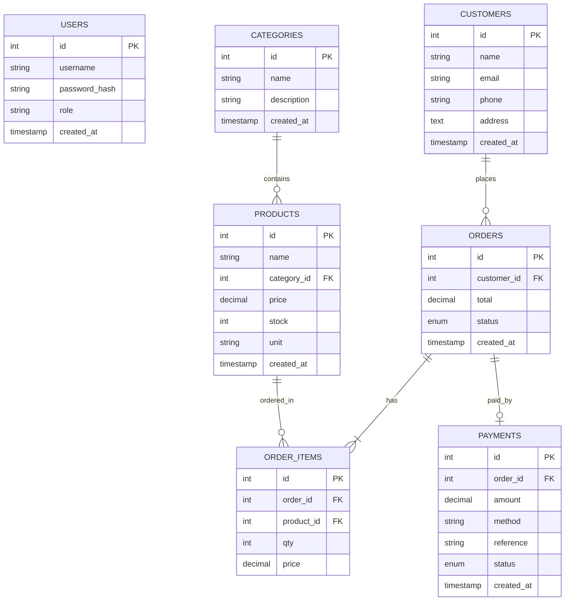

# 🛒 FreshMart — Online Grocery Store
> **Continuous Assessment (CA) — Practical 01 (30 Marks) & Practical 02 (20 Marks) & Viva (10 Marks)**  
> **Course / Module:** Web Application Development  
> **Total Score:** 60 Marks

---

## 📋 Table of Contents
1. [Project Overview](#project-overview)
2. [Marks Breakdown & Compliance Matrix](#marks-breakdown--compliance-matrix)
3. [Architecture & System Flow](#architecture--system-flow)
4. [Database Design (ER Diagram)](#database-design-er-diagram)
5. [Key Features](#key-features)
6. [Installation & Setup Instructions](#installation--setup-instructions)
7. [REST API Documentation](#rest-api-documentation)
8. [Viva Demonstration Guide](#viva-demonstration-guide)

---

## 🌟 Project Overview
**FreshMart** is a full-stack e-commerce web application designed for an Online Grocery Store. It provides customers with a responsive storefront to browse organic vegetables, fruits, dairy, bakery items, filter by category, search live using AJAX, manage a cart, and execute sandbox transactions. 

For store managers, it offers a secure, protected administrative dashboard featuring inventory CRUD, category management, stock alert warnings, real-time sales reporting, and order status tracking.

---

## 🎯 Marks Breakdown & Compliance Matrix

### Practical 01 — Core System (30 Marks)

| Requirement | Marks | Implementation in FreshMart |
| :--- | :---: | :--- |
| **HTML** | 3 | Semantic HTML5 tags (`<header>`, `<nav>`, `<main>`, `<section>`, `<article>`, `<footer>`, `<dialog>`, `<form>`, `<table>`). |
| **CSS** | 5 | Responsive Flexbox and CSS Grid layout, CSS custom properties (`:root`), media queries for desktop, tablet, and mobile. |
| **JavaScript** | 5 | DOM manipulation, event listeners (`addEventListener`), dynamic rendering of cards and tables, shopping cart state management. |
| **Validation & DOM** | 4 | Client-side validation in `validation.js` for required fields, email regex, phone numbers, quantities, prices, with immediate DOM error feedback. |
| **jQuery & AJAX** | 3 | jQuery interactions (`slideDown`, `fadeIn`, `fadeOut`), asynchronous `$.ajax` and `fetch` requests for zero-page-reload browsing. |
| **Node.js & Express**| 4 | Express server, modular REST API routes, centralized error handling, and JSON body parsing. |
| **MySQL & CRUD** | 6 | Relational MySQL database (`grocery`), parameterized queries with `mysql2/promise`, complete CRUD on Products, Categories, Customers, and Orders. |
| **Total** | **30** | **100% Fully Implemented** |

---

### Practical 02 — Enhancement (20 Marks)

| Requirement | Marks | Implementation in FreshMart |
| :--- | :---: | :--- |
| **Authentication** | 4 | Admin login/logout workflow with Express sessions, session cookies, and route protection middleware (`requireAuth`). |
| **Security** | 3 | Password hashing with `bcryptjs`, parameterized SQL statements (preventing SQL Injection), server-side input sanitization. |
| **Enhancement Features** | 5 | Inventory stock alerts (`stock <= 10`), sales revenue summary, category-wise sales breakdown, top 5 bestsellers, live keyword search, price/stock sorting. |
| **UI Improvements** | 3 | Polished dual-interface: modern customer storefront and dark-mode styled executive admin sidebar dashboard with stats cards. |
| **Payment Workflow**| 3 | Sandbox Mock Payment Gateway supporting Mock Credit/Debit Cards, UPI/QR, and Cash on Delivery with transaction reference generation (`TXN-GRC-XXXX`) and printable receipt. |
| **Documentation** | 2 | Comprehensive `README.md` and detailed `ENHANCEMENT_REPORT.md` explaining progression. |
| **Total** | **20** | **100% Fully Implemented** |

---

## 📐 Architecture & System Flow

```
[Customer Browser / Admin Browser]
              │
        HTTP / AJAX Requests
              │
              ▼
[Express Server (server.js)]
   ├── Session Middleware (express-session)
   ├── Auth Guard (requireAuth)
   ├── Routes:
   │     ├── /api/auth (Login, Logout, Session)
   │     ├── /api/products (CRUD, Stock Alerts, Filter)
   │     ├── /api/categories (CRUD)
   │     ├── /api/customers (Directory)
   │     ├── /api/orders (Transaction Checkout)
   │     ├── /api/payments (Mock Gateway & Receipts)
   │     └── /api/reports (Dashboard Analytics)
   │
   └── MySQL Connection Pool (db.js)
              │
              ▼
    [MySQL Database: `grocery`]
```

---

## 🗄️ Database Design (ER Diagram)



---

## 🚀 Installation & Setup Instructions

### 1. Prerequisites
- **Node.js** (v16 or higher)
- **MySQL / XAMPP / WampServer** running on port 3306

### 2. Database Configuration
Open MySQL console or phpMyAdmin and run the provided SQL file:
```bash
mysql -u root -p < schema.sql
```
*(Or use the existing `grocery` database created with XAMPP)*

Verify connection settings in `.env`:
```ini
PORT=3000
DB_HOST=127.0.0.1
DB_USER=root
DB_PASS=
DB_NAME=grocery
SESSION_SECRET=grocery_super_secret_session_key_2026
```

### 3. Install Dependencies
```bash
npm install
```

### 4. Start the Application
```bash
npm start
```
The server will start at:
- **Customer Storefront:** `http://localhost:3000`
- **Admin Login:** `http://localhost:3000/login`
- **Admin Dashboard:** `http://localhost:3000/admin`

---

## 🔐 Default Admin Credentials

| Parameter | Value |
| :--- | :--- |
| **Username** | `admin` |
| **Password** | `admin123` |
| **Role** | Super Administrator |

*(Passwords are securely hashed using bcrypt `cost 10`)*

---

## 📡 REST API Documentation

### Authentication
- `POST /api/auth/login` - Authenticate admin credentials
- `POST /api/auth/logout` - Invalidate session
- `GET /api/auth/me` - Check current login session

### Products
- `GET /api/products` - List products (supports query parameters: `search`, `category`, `lowStock`, `sort`)
- `GET /api/products/:id` - Fetch single product
- `POST /api/products` *(Protected)* - Create new product
- `PUT /api/products/:id` *(Protected)* - Update existing product
- `DELETE /api/products/:id` *(Protected)* - Delete product

### Categories
- `GET /api/categories` - List categories with product counts
- `POST /api/categories` *(Protected)* - Create category
- `PUT /api/categories/:id` *(Protected)* - Update category
- `DELETE /api/categories/:id` *(Protected)* - Delete category

### Orders & Payments
- `GET /api/orders` - List customer orders
- `GET /api/orders/:id` - Get order details with item breakdown
- `POST /api/orders` - Checkout cart, decrement stock, create order transaction
- `PUT /api/orders/:id/status` *(Protected)* - Change order status
- `POST /api/payments/process` - Process mock transaction, generate TXN code & invoice

### Reports & Analytics
- `GET /api/reports/dashboard` *(Protected)* - Retrieve total revenue, top-selling items, category sales, and low-stock alerts

---

## 🎓 Viva Demonstration Guide (10 Marks)

1. **System Demo (2 Marks):**
   - Open `http://localhost:3000` and demonstrate live search and category filtering.
   - Add items to the cart, alter quantities, and observe dynamic DOM total updates.
   - Proceed to checkout, fill customer form, choose "Mock Card", enter sandbox card, and complete checkout.
   - Show the generated printable receipt with transaction reference.

2. **Front-End Explanation (2 Marks):**
   - Explain responsive design using CSS Flexbox & CSS Grid in `style.css`.
   - Explain DOM updates, event handling, and jQuery AJAX calls in `app.js`.
   - Explain client-side validation logic in `validation.js`.

3. **Back-End Explanation (2 Marks):**
   - Explain Express routing in `server.js` and modular routes in `routes/`.
   - Explain the SQL transaction in `routes/orders.js` that ensures order creation and stock decrement happen atomically.

4. **Database & CRUD (2 Marks):**
   - Explain the 7 relational tables, foreign key constraints, and cascade actions.
   - Explain parameterized queries (`?`) preventing SQL Injection.

5. **Security & Enhancements (2 Marks):**
   - Explain bcrypt password hashing in `routes/auth.js`.
   - Explain session middleware in `middleware/auth.js`.
   - Show the Admin Dashboard reports (`/admin`) with real-time stock alert warnings and category revenue bars.
